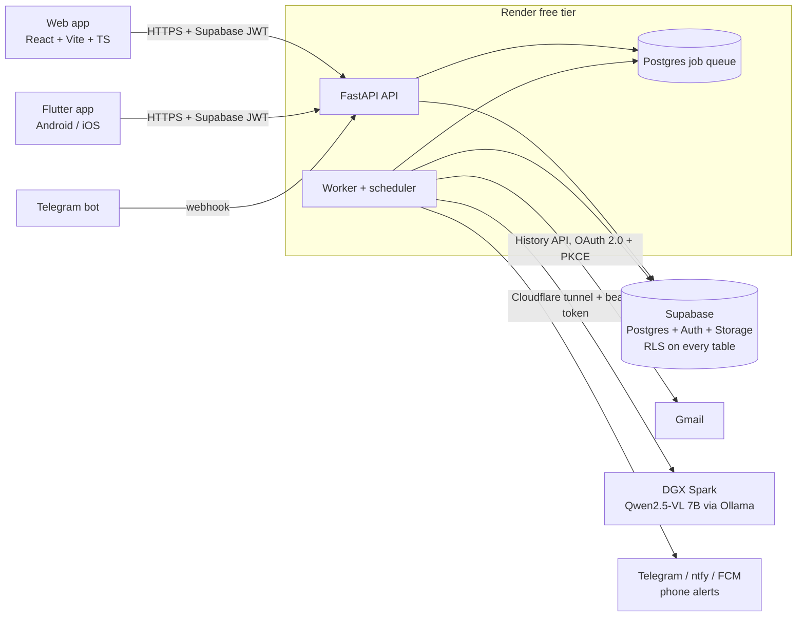

# MailPilot AI

**An AI email assistant that triages your Gmail, never misses an internship or job offer, and lets you run your inbox from Telegram, all on a self-hosted LLM.**

[](https://mailpilot-web-n41v.onrender.com/dashboard)
[](https://mailpilot-api-cpi3.onrender.com/docs)

| | |
|---|---|
| **Live app** | <https://mailpilot-web-n41v.onrender.com/dashboard> (sign in with Google) |
| **API** | <https://mailpilot-api-cpi3.onrender.com> · interactive docs at [`/docs`](https://mailpilot-api-cpi3.onrender.com/docs) |
| **Mobile** | Flutter app for Android and iOS ([`mobile/`](mobile/README.md)) |

> Hosted on Render's free tier, so the first request after a quiet period can take up to a minute while the service wakes.

---

## What it does

MailPilot connects to Gmail, syncs mail into Postgres, and analyses every message on a **self-hosted Qwen2.5-VL model running on an NVIDIA DGX Spark**. No email content goes to a third-party AI API.

**Human approval is required for every consequential action.** MailPilot never sends, archives, labels or deletes mail on its own; it proposes, you approve.

### Features

- **AI priority inbox.** Every email gets a HIGH / MEDIUM / LOW priority with a plain-English reason, a summary, and extracted tasks, commitments and deadlines with the evidence quoted from the mail.
- **Career-offer priority.** Internship and job offers, offer letters, shortlists and interview or assessment invites are always forced to HIGH and trigger an instant phone alert. Job-alert newsletters are filtered out so only real opportunities get escalated.
- **Telegram assistant.** Each user connects their own Telegram bot and can find and explain mail, ask questions about their inbox, and write replies in rough English. The bot rewrites them professionally and shows a preview with **Approve / Rewrite / Delete** before anything is sent.
- **Convert to professional.** A one-click rewrite in the web Compose window turns a rough draft into a polished email.
- **Gmail-style Compose.** Recipient autocomplete ranked by how recently and often you write to someone (with typo tolerance), and a 10-second undo after send.
- **Auto-sync with new-mail popups.** Incremental Gmail sync every minute through the History API, with an in-app popup when new mail lands.
- **Phone alerts.** Important mail is pushed to your phone through Telegram, ntfy or Firebase Cloud Messaging.
- **Flutter mobile app.** Native Android and iOS app with Inbox filters (High priority, Offers & interviews, Needs reply), AI summaries, "Reply with AI", Compose, Approvals, Tasks and push notifications.
- **Approvals workflow.** Drafted replies, labels and archives wait in an approval queue and run only after you approve their exact content.
- **Daily briefings.** A morning summary of what needs attention, upcoming deadlines and open commitments.
- **Phishing detection.** Sender spoofing, lookalike domains, risky links and urgency tactics are flagged, and a phishing risk always overrides any priority boost.
- **Natural-language search, attachment analysis, contacts and analytics.** Search mail by meaning, get summaries of PDFs and documents, and see who you talk to most.

---

## Architecture



- **API and worker.** FastAPI serves a versioned REST API (`/api/v1`). A worker processes a durable Postgres job queue (`FOR UPDATE SKIP LOCKED`, leases, retries, dedupe) for Gmail sync, AI analysis, sends, briefings and notifications.
- **Self-hosted inference.** The LLM runs on an NVIDIA DGX Spark behind a bearer-token proxy, reached from the cloud through a secure Cloudflare tunnel. The LLM layer is provider-neutral (any OpenAI-compatible server: Ollama, vLLM, SGLang, NIM), has a circuit breaker, and falls back to rule-based analysis if the model is offline.
- **Security.** Supabase Auth (Google sign-in, JWKS-verified JWTs), row-level security on every table, Gmail and Telegram tokens encrypted at rest with rotatable Fernet keys, prompt-injection defences on email content, and rate limiting. See [docs/SECURITY.md](docs/SECURITY.md).
- **Deployment.** API, worker and static web app on Render's free tier, Postgres, Auth and Storage on Supabase's free tier, defined in [`render.yaml`](render.yaml).

More detail in [docs/ARCHITECTURE.md](docs/ARCHITECTURE.md).

---

## Tech stack

| Layer | Technology |
|---|---|
| Frontend | React 19, TypeScript (strict), Vite, React Router, TanStack Query, React Hook Form + Zod, Recharts, Tailwind CSS |
| Component library | Storybook with interaction tests and axe accessibility checks |
| Mobile | Flutter (Android + iOS), Riverpod, go_router, Firebase Cloud Messaging |
| Backend | Python, FastAPI, Pydantic, SQLAlchemy 2 (asyncpg), structlog |
| Data | Supabase Postgres (RLS), Supabase Auth, Supabase Storage, pgvector, pg_trgm |
| Jobs | Durable Postgres job queue with leases, retries and a scheduler |
| AI | Qwen2.5-VL 7B on NVIDIA DGX Spark (Ollama), OpenAI-compatible adapter, structured outputs |
| Integrations | Gmail REST API (OAuth 2.0 + PKCE, History API), Telegram Bot API, ntfy, FCM |
| Infra and CI | Docker, docker-compose, Render, Cloudflare Tunnel, GitHub Actions |
| Testing | pytest (unit, integration against real Postgres, live DGX contract tests), Vitest, Playwright E2E |

---

## Repository layout

```
backend/        FastAPI app, worker, tests
  app/api/v1/   REST endpoints (OpenAPI at /docs)
  app/gmail/    OAuth, client, MIME parser, incremental sync
  app/llm/      provider-neutral LLM layer, prompts, output schemas
  app/analysis/ rules, scoring, phishing, deadlines, search, briefings, attachments
  app/actions/  drafts and the approval/execution engine
  app/jobs/     durable queue, handlers, worker + scheduler
  app/services/ notifications, Telegram assistant, writing assistant, push
frontend/       React web app, design system and Storybook stories
mobile/         Flutter Android/iOS app
supabase/       migrations (schema, RLS, storage) and synthetic seed data
scripts/        local launcher, checks, DGX LLM proxy
docs/           setup, architecture, security, operations, status
```

---

## Run it locally

Prerequisites: Python 3.12+, Node 24+, Docker Desktop, Git.

```powershell
cd backend
py -m venv .venv
.venv\Scripts\python.exe -m pip install -r requirements-dev.txt
Copy-Item .env.example .env
cd ..\frontend
npm ci
Copy-Item .env.example .env.local
cd ..
npm start
```

- Web app: <http://localhost:5173> (local seed login `demo@mailpilot.test` / `mailpilot-demo-password`, synthetic data)
- API docs: <http://localhost:8000/docs>
- Storybook: <http://localhost:6006>

Run all checks with `.\scripts\check.ps1` (add `-E2E` for browser tests).

## Documentation

- [Setup](docs/SETUP.md): Supabase, Google OAuth, Gmail and environment variables
- [DGX Spark](docs/DGX_SPARK.md): self-hosted inference, tunnelling and diagnostics
- [Architecture](docs/ARCHITECTURE.md): data flow, approval state machine and scoring
- [Security](docs/SECURITY.md): threat model and prompt-injection defences
- [Operations](docs/OPERATIONS.md): deployment, backups and troubleshooting
- [User guide](docs/USER_GUIDE.md): how to use the app
- [Status](docs/STATUS.md): feature status and test results
- [Mobile app](mobile/README.md): Flutter build and push setup
